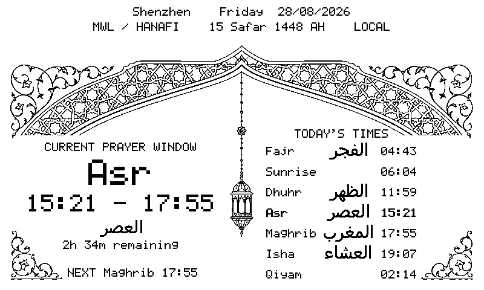
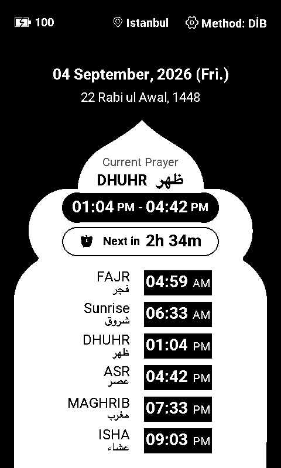
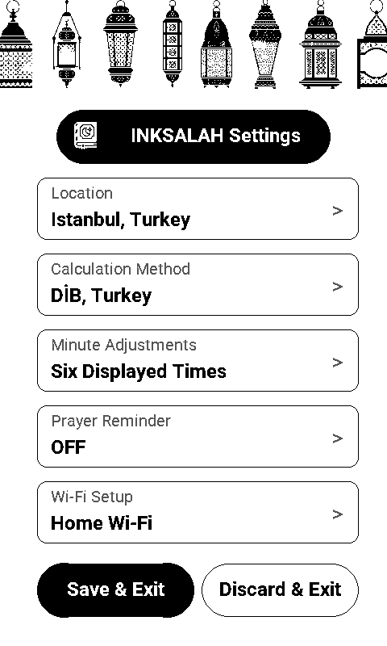
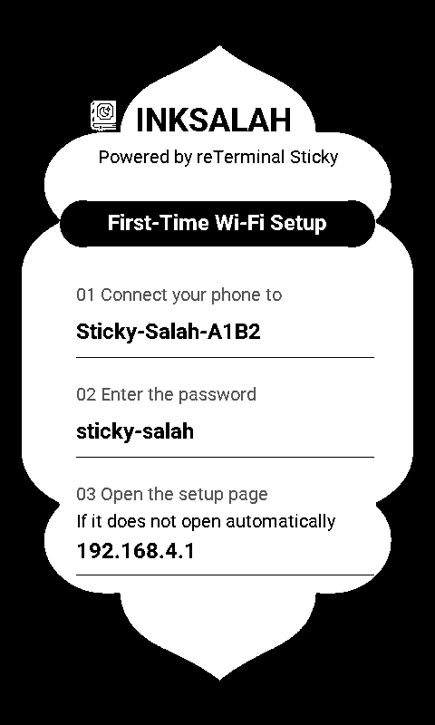
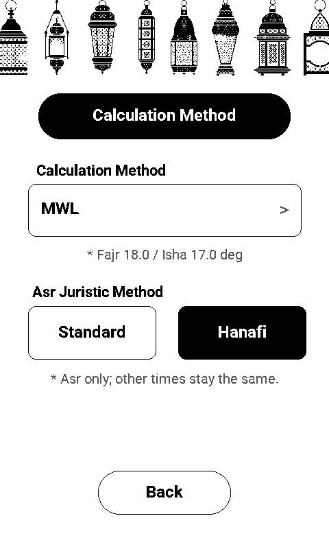
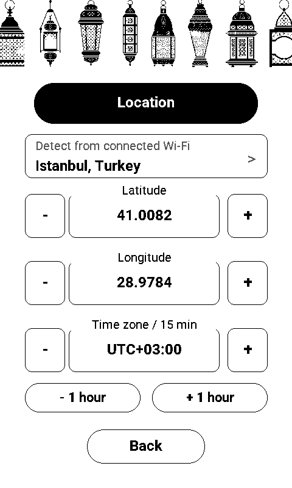
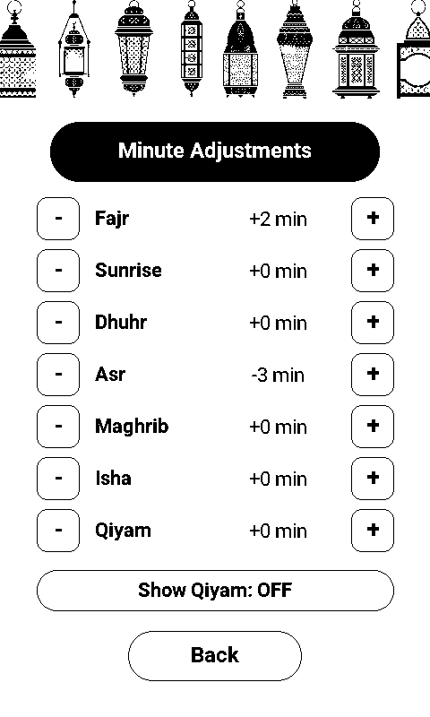

<div align="center">

# InkSalah for reTerminal Sticky

### Old and new Sticky screens

The same firmware automatically supports the original SSD1677 and revised SSD2677 screens. At boot it reads register `0x70`: `0x07` selects SSD2677; any other successful response selects the legacy SSD1677 path. A SPI read error fails initialization rather than silently falling back. The detected controller and raw ID are printed to the serial log.

Display reads and writes share GPIO14 at 2 MHz; GPIO12 remains the shared MicroSD return line.

Both controllers support the existing four-level grayscale UI, monochrome partial transitions, rotation, and sleep/wake. See [screen compatibility and hardware checks](docs/SCREEN_COMPATIBILITY.md) before publishing firmware for a new hardware batch.

## A private, offline-first prayer-time display built for ePaper

[简体中文](README_CN.md) · [Prayer calculation](docs/PRAYER_CALCULATION.md) · [Development guide](docs/DEVELOPMENT.md) · [Changelog](CHANGELOG.md)

[](https://github.com/limengdu/reTerminal_Sticky_InkSalah/actions/workflows/ci.yml)
[](LICENSE)
[](platformio.ini)
[](https://www.seeedstudio.com/reterminal-sticky.html)

</div>

<p align="center">
  
</p>

InkSalah turns the Seeed Studio reTerminal Sticky into a calm, always-visible Salah companion. It calculates prayer times locally from coordinates, date, time zone, calculation method, and Asr school. Wi-Fi is used for clock synchronization and optional approximate location detection—not for downloading prayer timetables.

> Prayer times shown by this firmware are calculated time-window boundaries. For congregational prayer and local religious guidance, follow the timetable and iqamah schedule published by your mosque or trusted local authority.

## Current version: 0.1.2

- **Screen and touch compatibility:** automatic SSD1677/SSD2677 detection and synchronized GT911 startup. Runtime logs, the ESP-IDF application descriptor, and the HTTP User-Agent now share version 0.1.2. This version-aligned rebuild requires physical-device acceptance.
- **A complete device UI:** Roboto typography, connected Arabic labels, AM/PM times, and separate portrait and landscape arch layouts.
- **Direct header controls:** aligned status icons and text, generous gear and location touch targets, and one-tap access to Location.
- **Consistent rounded controls:** continuous capsule edges across prayer times, countdowns, and settings buttons.
- **A retained sleep display:** the prayer page and crescent remain visible when an orientation wake settles in the same direction.

See the [changelog](CHANGELOG.md) for the full update and [CI builds](https://github.com/limengdu/reTerminal_Sticky_InkSalah/actions/workflows/ci.yml) for automated tests and build artifacts.

## Why InkSalah

- **Prayer windows, not isolated alarms.** See the current window, its end, remaining time, and the next obligatory prayer.
- **Offline-first calculation.** Fajr, Sunrise, Dhuhr, Asr, Maghrib, Isha, and Qiyam are calculated on the ESP32-S3.
- **Recognizable calculation choices.** Select from 23 established regional or institutional profiles, two custom profiles, and Standard or Hanafi Asr rules.
- **Local adjustment.** Apply an independent ±30 minute correction to each displayed time.
- **Optional Qiyam.** Show or hide Qiyam without changing the Isha window.
- **Native device settings.** Prayer configuration lives on the touchscreen; the captive portal is dedicated to Wi-Fi setup.
- **Portrait and landscape layouts.** A single arch in portrait and paired arches in landscape frame the current prayer and daily schedule. The IMU changes orientation after the device is physically rotated.
- **Designed for ePaper.** Fast interaction refreshes, persistent monochrome artwork, and a three-minute idle path into deep sleep.
- **Roboto typography.** Native-sized regular and bold glyphs, AM/PM time badges, and connected Arabic prayer labels.
- **Private by design.** Wi-Fi credentials and prayer settings stay in ESP32 NVS storage.

## Interface

<table>
  <tr>
    <td align="center"></td>
    <td align="center"></td>
  </tr>
  <tr>
    <td align="center"><strong>Prayer window</strong><br />Current window, countdown, and six daily times</td>
    <td align="center"><strong>On-device settings</strong><br />Five categories with Save & Exit and Discard & Exit</td>
  </tr>
  <tr>
    <td align="center"></td>
    <td align="center"></td>
  </tr>
  <tr>
    <td align="center"><strong>Wi-Fi onboarding</strong><br />Connect your phone, enter the password, and open setup</td>
    <td align="center"><strong>Calculation rules</strong><br />Institutional profile and independent Asr school</td>
  </tr>
</table>

These screenshots are generated from the native renderer in version **0.1.1**, using the same artwork, Roboto glyphs, and drawing functions as the device. The prayer examples use Istanbul and 4 September 2026 as a fixed demonstration scenario.

Additional views: [Qiyam enabled](docs/images/prayer-portrait-qiyam.png) · [sleep crescent](docs/images/ui-review/portrait-sleep.png) · [status-bar alignment](docs/images/ui-review/status-bar-alignment.png) · [rounded-control details](docs/images/ui-review/rounded-controls.png).

The prayer header groups battery status on the left, location in the center, and the calculation method with a settings shortcut on the right. Icons and text share one horizontal centerline. A crescent appears beside the battery during deep sleep. Tap the location icon or city name to open Location directly; the gear opens the settings homepage. Both shortcuts have expanded touch areas around their artwork. Wide method names use the available space for the institution name, and long labels are shortened visually while the full setting remains saved.

## Hardware target

| Component | Use in InkSalah |
| --- | --- |
| ESP32-S3R8, 32 MB flash | Application, prayer calculation, connectivity, and low-power control |
| 800 × 480 monochrome ePaper | Portrait and landscape persistent UI |
| GT911 | Touch, taps, and edge-swipe gestures |
| LSM6DS3TR-C | Orientation and low-power rotation wake-up |
| PCF8563 | Local calendar time and scheduled wake-up |
| BQ27220 | Battery state of charge |
| Buzzer | Optional prayer-boundary reminder |

The project targets the [Seeed Studio reTerminal Sticky](https://www.seeedstudio.com/reterminal-sticky.html) and builds with PlatformIO, Espressif32 `6.11.0`, and ESP-IDF `5.4.1`.

## Quick start

### Requirements

- reTerminal Sticky
- USB-C data cable
- [PlatformIO Core](https://docs.platformio.org/en/latest/core/installation/index.html) 6.x or the PlatformIO IDE extension
- Python 3 for host-side tests and preview helpers

### Clone and build

```bash
git clone https://github.com/limengdu/reTerminal_Sticky_InkSalah.git
cd reTerminal_Sticky_InkSalah
pio run -e sticky-salah-release
```

A successful build creates:

```text
.pio/build/sticky-salah-release/firmware.bin
```

### Upload and monitor

List the available serial ports:

```bash
pio device list
```

Replace `/dev/cu.usbmodemXXXX` with the port reported for your device:

```bash
pio run -e sticky-salah-release -t upload --upload-port /dev/cu.usbmodemXXXX
pio device monitor --port /dev/cu.usbmodemXXXX --baud 115200
```

For verbose diagnostics, build and upload `sticky-salah-debug` instead.

## First-time setup

1. Power on the device and connect your phone to `Sticky-Salah-XXXX`.
2. Enter the setup password `sticky-salah`.
3. Use the captive page that opens automatically, or visit `http://192.168.4.1`.
4. Select a scanned Wi-Fi network or type a hidden SSID, then choose **Check and save**.
5. Continue on the Sticky screen: confirm location and time zone, choose a calculation method and Asr school, then apply any local minute adjustments.
6. Choose **Save & Start** to validate and store the configuration.

The IP-based location result is an estimate. Confirm the coordinates and UTC offset before saving.

## Daily controls

| Gesture or action | Result |
| --- | --- |
| Swipe up from the bottom of the prayer screen | Open native settings |
| Tap the gear on the prayer screen | Open native settings |
| Tap the location icon or city name | Open native Location settings directly |
| Swipe down from the top of settings | Validate, save, and return to the prayer screen |
| Swipe right from the left edge inside a settings subpage | Return one level while keeping the draft |
| Rotate the device | Switch between portrait and landscape after orientation settles |
| Leave the device untouched for three minutes | Enter deep sleep with timer, button, and orientation wake sources |

An orientation wake that settles in the same screen direction preserves the displayed page and crescent, then resumes deep sleep. A changed orientation, timer wake, or button wake follows the regular page-rendering flow.

**Prayer Reminder** controls the optional buzzer at prayer boundaries. **Minute Adjustments → Show Qiyam** controls whether Qiyam appears in the schedule; hiding it leaves Isha active until the next Fajr. The settings homepage contains Location, Calculation Method, Minute Adjustments, Prayer Reminder, and Wi-Fi Setup.

The prayer screen uses 12-hour times with explicit **AM/PM** labels. The first-time setup screen offers **Save & Start**; subsequent settings sessions offer **Save & Exit** and **Discard & Exit**. **Back** in Wi-Fi setup returns to native settings using the saved network.

## Settings on the device

| Section | What you can configure |
| --- | --- |
| **Location** | Estimate location through the saved Wi-Fi network, enter latitude and longitude, and adjust the fixed UTC offset |
| **Calculation Method** | Choose an institution or custom twilight rule, then select Standard or Hanafi for Asr |
| **Minute Adjustments** | Adjust each boundary by ±30 minutes and toggle **Show Qiyam** |
| **Prayer Reminder** | Enable or disable the prayer-boundary buzzer |
| **Wi-Fi Setup** | Open the phone provisioning flow; **Back** returns with the saved network |

<table>
  <tr>
    <td align="center"></td>
    <td align="center"></td>
  </tr>
  <tr>
    <td align="center"><strong>Location</strong><br />Tap the city or location pin to open this page directly</td>
    <td align="center"><strong>Minute adjustments</strong><br />Independent offsets and an optional Qiyam row</td>
  </tr>
</table>

Settings remain on the device in portrait orientation. Returning one level keeps the draft; **Save & Exit** applies it and **Discard & Exit** restores the saved configuration. The coordinate keypad uses **Delete** to clear the field, **Back** to remove one character, and **OK** to confirm. Wi-Fi setup and regular settings return to the device flow without restarting it.

## Prayer-time model

The calculation engine uses latitude, longitude, civil date, fixed UTC offset, twilight profile, and Asr shadow rule. It calculates yesterday, today, and tomorrow so Isha and Qiyam remain correct across midnight.

The six standard boundaries and optional Qiyam are:

- **Fajr** — start of the dawn prayer window.
- **Sunrise** — end of Fajr; a boundary rather than one of the five obligatory prayers.
- **Dhuhr** — start after local solar noon.
- **Asr** — start under the Standard or Hanafi shadow rule.
- **Maghrib** — start at sunset, or the selected method's configured boundary.
- **Isha** — start at the selected twilight angle or post-Maghrib interval.
- **Qiyam** — beginning of the final third of the night, calculated from Maghrib to the next Fajr.

See [Prayer calculation](docs/PRAYER_CALCULATION.md) for the full method table, high-latitude behavior, adjustments, and known limits.

## Privacy and network use

| Data or service | Behavior |
| --- | --- |
| Wi-Fi credentials | Stored locally in ESP32 NVS |
| Prayer settings | Stored locally in ESP32 NVS |
| Prayer timetable | Calculated locally; no timetable API is called |
| Clock synchronization | Uses SNTP while online |
| Location detection | Optional request to `ipwho.is`; returns an approximate public-IP location |

InkSalah stores a fixed UTC offset. Review it when daylight-saving rules change or after moving to another time zone.

## Project structure

```text
boards/                 PlatformIO board definition
components/             ePaper, touch, and logging components
docs/                   Calculation and development documentation
src/app/                Application cycle and native settings flow
src/board/              Power, GPIO, I2C, and shared SPI setup
src/devices/            RTC, battery, button, and buzzer integration
src/input/              Touch and gesture handling
src/location/           Country and location defaults
src/network/            Wi-Fi, captive portal, SNTP, and IP location
src/prayer/             Solar calculation and prayer-window rules
src/storage/            Versioned NVS settings
src/ui/                 Canvas, fonts, artwork, and device pages
test/                   Host-side behavior and policy tests
tools/                  Test runners and UI preview tools
```

## Development

Run the complete host test suite without hardware:

```bash
bash tools/run_host_tests.sh
```

Expected result:

```text
[host-test] PASS 31/31
```

Build both firmware profiles before submitting a change:

```bash
pio run -e sticky-salah-release
pio run -e sticky-salah-debug
```

See [Development guide](docs/DEVELOPMENT.md) for UI previews, source layout, verification steps, and contribution expectations.

## Project status

InkSalah is an early community firmware release. The calculation engine, settings flow, rendered UI, storage migration, and network policies have automated coverage; touch feel, display waveform behavior, wake-up reliability, and battery life still require validation on physical hardware for each release.

Bug reports and focused pull requests are welcome. Start with [CONTRIBUTING.md](CONTRIBUTING.md), and report sensitive issues through [SECURITY.md](SECURITY.md).

## Credits and license

InkSalah is released under the [MIT License](LICENSE). Board integration and selected low-level drivers were adapted from the MIT-licensed [reTerminal Sticky Bunny](https://github.com/limengdu/reTerminal_Sticky_Bunny) project. Managed Espressif components retain their upstream licenses. Exact attributions are recorded in [NOTICE.md](NOTICE.md).

reTerminal Sticky is a product of Seeed Studio. InkSalah is a community project and is not factory firmware, an official Seeed Studio product, or a religious authority.
