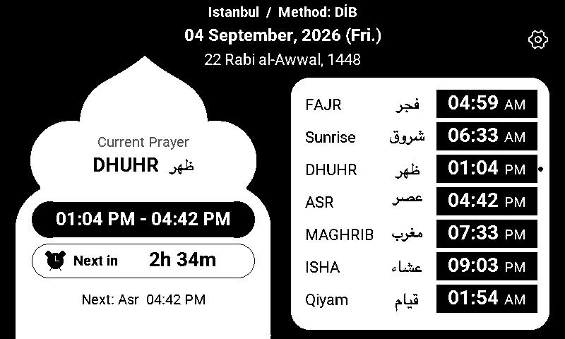
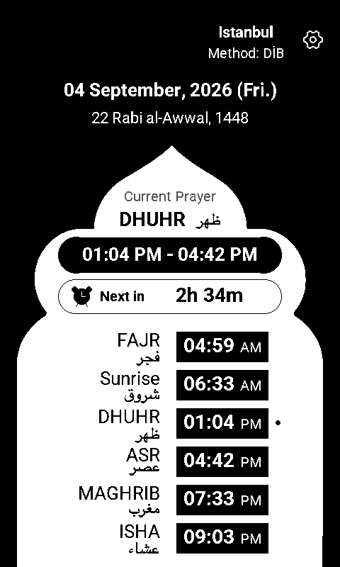
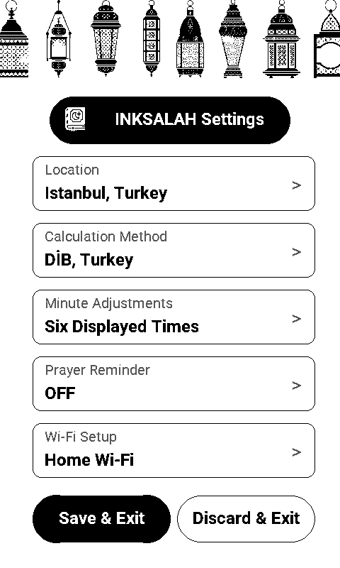

<div align="center">

# InkSalah for reTerminal Sticky

### 一款隐私友好、离线优先的墨水屏礼拜时间固件

[English](README.md) · [礼拜时间算法](docs/PRAYER_CALCULATION_CN.md) · [开发指南](docs/DEVELOPMENT.md) · [更新记录](CHANGELOG.md)

[](https://github.com/limengdu/reTerminal_Sticky_InkSalah/actions/workflows/ci.yml)
[](LICENSE)
[](platformio.ini)
[](https://www.seeedstudio.com/reterminal-sticky.html)

</div>

<p align="center">
  
</p>

InkSalah 将 Seeed Studio reTerminal Sticky 变成一块安静、常显的礼拜时间牌。它根据经纬度、日期、时区、计算机构和 Asr 教法规则，在 ESP32-S3 上直接计算每天的礼拜时间。Wi-Fi 只用于校时和可选的粗略定位，不用于下载在线礼拜时间表。

> 固件显示的是按所选规则计算出的礼拜时间窗口边界。参加集体礼拜或处理当地宗教实践时，请以清真寺或可信当地机构公布的时刻表及 iqamah 安排为准。

## 为什么做 InkSalah

- **显示时间窗口，而不只显示一个闹钟时刻。** 页面会告诉你当前处在哪个礼拜窗口、什么时候结束、还剩多久以及下一次必行礼拜。
- **离线计算。** Fajr、Sunrise、Dhuhr、Asr、Maghrib、Isha 和 Qiyam 都由设备本地计算。
- **计算规则清楚可选。** 内置 23 种通行机构或地区规则、两种自定义规则，以及 Standard/Hanafi 两种 Asr 规则。
- **支持当地微调。** 七个时间都可独立调整 ±30 分钟，方便与当地清真寺时刻表对齐。
- **Qiyam 可选显示。** 关闭 Qiyam 后，Isha 窗口仍然持续到次日 Fajr。
- **Roboto 字体。** 英文和数字使用原生像素字号的常规体与粗体，时间明确标注 AM/PM，阿拉伯语采用连写字形。
- **礼拜设置全部在设备上完成。** 手机热点页面只负责 Wi-Fi，不混入宗教参数。
- **横竖屏独立设计。** 设备转动并稳定后，IMU 会切换到对应布局。
- **为墨水屏设计。** 设置操作使用快刷，页面长期保持可读，三分钟无操作后进入深度睡眠。
- **隐私优先。** Wi-Fi 凭据和礼拜参数保存在 ESP32 的 NVS 本地存储中。

## 界面

<table>
  <tr>
    <td align="center"></td>
    <td align="center"></td>
  </tr>
  <tr>
    <td align="center"><strong>礼拜窗口</strong><br />当前状态和当天时间轴</td>
    <td align="center"><strong>设备原生设置</strong><br />地点、算法、微调、提醒与 Qiyam</td>
  </tr>
</table>

以上图片直接由固件使用的画布和页面代码渲染，并非另外制作的概念稿。

## 硬件目标

| 硬件 | 在 InkSalah 中的作用 |
| --- | --- |
| ESP32-S3R8，32 MB Flash | 应用、礼拜计算、联网和低功耗控制 |
| 800 × 480 黑白墨水屏 | 横屏和竖屏常显界面 |
| GT911 | 点击与边缘滑动手势 |
| LSM6DS3TR-C | 屏幕方向和低功耗转动唤醒 |
| PCF8563 | 本地日期时间和定时唤醒 |
| BQ27220 | 电池电量读取 |
| 蜂鸣器 | 可选的礼拜边界提示音 |

项目面向 [Seeed Studio reTerminal Sticky](https://www.seeedstudio.com/reterminal-sticky.html)，使用 PlatformIO、Espressif32 `6.11.0` 和 ESP-IDF `5.4.1` 构建。

## 快速开始

### 准备条件

- reTerminal Sticky
- USB-C 数据线
- [PlatformIO Core](https://docs.platformio.org/en/latest/core/installation/index.html) 6.x 或 PlatformIO IDE 插件
- Python 3，用于电脑端测试和预览工具

### 克隆与构建

```bash
git clone https://github.com/limengdu/reTerminal_Sticky_InkSalah.git
cd reTerminal_Sticky_InkSalah
pio run -e sticky-salah-release
```

成功后会生成：

```text
.pio/build/sticky-salah-release/firmware.bin
```

### 烧录与查看日志

先列出串口：

```bash
pio device list
```

把下面的 `/dev/cu.usbmodemXXXX` 换成实际串口：

```bash
pio run -e sticky-salah-release -t upload --upload-port /dev/cu.usbmodemXXXX
pio device monitor --port /dev/cu.usbmodemXXXX --baud 115200
```

需要详细排查信息时，构建并烧录 `sticky-salah-debug`。

## 第一次设置

1. 设备启动后，手机连接 `Sticky-Salah-XXXX` 热点。
2. 输入热点密码 `sticky-salah`。
3. 使用手机自动弹出的配网页，或访问 `http://192.168.4.1`。
4. 从扫描列表选择 Wi-Fi，也可以手动填写隐藏网络；点击 **Check and save**。
5. 回到 Sticky 屏幕，核对地点和 UTC 偏移，选择计算机构与 Asr 规则，并按当地需要做分钟微调。
6. 点击 **Save & Start**，设备会先验证设置，再保存并进入礼拜主页面。

公网 IP 定位只能给出大致地点，保存前应核对经纬度和 UTC 偏移。

## 日常操作

| 手势或操作 | 结果 |
| --- | --- |
| 从礼拜页面底部向上滑 | 打开设备原生设置 |
| 点击礼拜页面的齿轮 | 打开设备原生设置 |
| 从设置页面顶部向下滑 | 验证、保存并返回礼拜页面 |
| 在设置子页面从左侧边缘向右滑 | 返回上一级并保留草稿 |
| 转动设备 | 姿态稳定后切换横屏或竖屏 |
| 三分钟没有操作 | 进入深度睡眠，并保留定时器、顶部按键和姿态唤醒 |

**Prayer Reminder** 控制礼拜边界提示音。**Minute Adjustments → Show Qiyam** 控制 Qiyam 是否出现在时刻表和夜间状态中；关闭后 Isha 仍持续到次日 Fajr。设置首页包含 Location、Calculation Method、Minute Adjustments、Prayer Reminder 和 Wi-Fi Setup 五个入口。

礼拜页面使用明确标注 **AM/PM** 的 12 小时制。首次设置显示 **Save & Start**，日常设置显示 **Save & Exit** 和 **Discard & Exit**。Wi-Fi 配网页的 **Back** 按钮使用已保存网络返回设备设置。

## 礼拜时间模型

计算器读取经纬度、公历日期、固定 UTC 偏移、晨昏规则和 Asr 影长规则。设备同时计算昨天、今天和明天，保证跨午夜的 Isha 与 Qiyam 判断正确。

- **Fajr**：晨礼窗口开始。
- **Sunrise**：Fajr 结束；它是时间边界，不属于五番必行礼拜。
- **Dhuhr**：当地太阳正午之后开始。
- **Asr**：按 Standard 或 Hanafi 影长规则开始。
- **Maghrib**：日落或所选规则定义的昏礼边界。
- **Isha**：按暮光角度或 Maghrib 后固定分钟数开始。
- **Qiyam**：从 Maghrib 到次日 Fajr 的最后三分之一开始。

完整的机构简称、角度、分钟规则、高纬度处理和已知限制见[礼拜时间算法](docs/PRAYER_CALCULATION_CN.md)。

## 隐私与网络边界

| 数据或服务 | 实际行为 |
| --- | --- |
| Wi-Fi 凭据 | 保存在 ESP32 NVS |
| 礼拜设置 | 保存在 ESP32 NVS |
| 礼拜时间表 | 设备本地计算，不调用在线时间表 API |
| 时间校准 | 联网时使用 SNTP |
| 自动定位 | 用户触发后请求 `ipwho.is`，根据公网 IP 返回近似位置 |

InkSalah 当前保存固定 UTC 偏移。跨越时区、移动地点或夏令时变化后，请在设置中重新核对。

## 代码结构

```text
boards/                 PlatformIO 板卡定义
components/             墨水屏、触摸和日志组件
docs/                   算法与开发文档
src/app/                应用周期和设备原生设置流程
src/board/              供电、GPIO、I2C 与共享 SPI
src/devices/            RTC、电池、按键和蜂鸣器
src/input/              触摸与手势
src/location/           国家与地点默认参数
src/network/            Wi-Fi、配网、SNTP 和公网 IP 定位
src/prayer/             太阳位置计算与礼拜窗口
src/storage/            带版本迁移的 NVS 设置
src/ui/                 画布、字体、图案和设备页面
test/                   电脑端逻辑与策略测试
tools/                  测试与界面预览工具
```

## 开发与测试

不连接硬件即可运行全部电脑端测试：

```bash
bash tools/run_host_tests.sh
```

成功标志：

```text
[host-test] PASS 26/26
```

提交改动前构建两套固件：

```bash
pio run -e sticky-salah-release
pio run -e sticky-salah-debug
```

界面预览、模块说明和完整验证流程见[开发指南](docs/DEVELOPMENT.md)。

## 项目状态

InkSalah 目前属于早期开源固件。礼拜计算、设置流程、页面渲染、存储迁移和网络策略已有自动测试；每次发布仍需在实体设备上验证触摸手感、墨水屏刷新、睡眠唤醒和续航。

欢迎提交清晰、范围集中的问题和改动。参与开发前请阅读 [CONTRIBUTING.md](CONTRIBUTING.md)，敏感安全问题按 [SECURITY.md](SECURITY.md) 提交。

## 来源与许可证

InkSalah 使用 [MIT License](LICENSE)。板级适配和部分底层驱动整理自同为 MIT 许可证的 [reTerminal Sticky Bunny](https://github.com/limengdu/reTerminal_Sticky_Bunny) 项目；Espressif 托管组件保留各自的上游许可证。完整来源记录见 [NOTICE.md](NOTICE.md)。

reTerminal Sticky 是 Seeed Studio 的产品。InkSalah 是社区固件，不是设备出厂固件、Seeed Studio 官方产品或宗教裁决来源。
